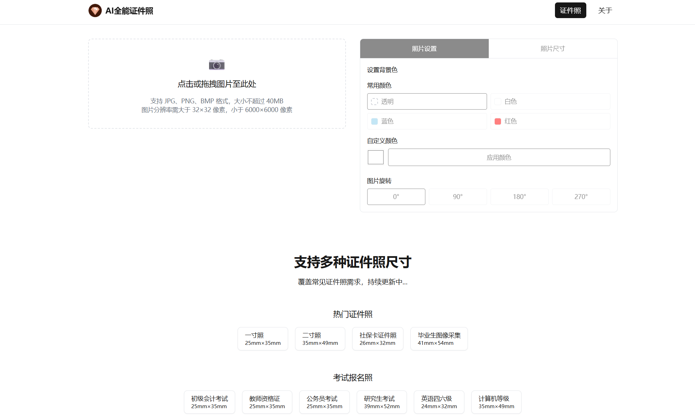

# AI全能证件照

一个无需注册或登录的证件照处理工具。网站提供「证件照」和「关于我们」两个页面，支持智能抠图、换底色、尺寸选择、裁剪、旋转和图片下载，不设会员或使用次数限制。

## 功能

- 点击或拖拽上传图片，调用阿里云高清人体分割接口去除背景。
- 切换透明背景、预设底色或自定义颜色，实时查看处理效果。
- 按证件类型搜索和选择尺寸，调整裁剪框。
- 旋转图片、对比原图与效果图、下载结果或重新选择图片。



## 技术栈

- Node.js 24（项目固定版本：24.21.0 LTS）
- Next.js 15.1.2、React 19、TypeScript
- Tailwind CSS、Lucide 图标、Framer Motion
- 阿里云图像分割 SDK、Sharp

## Windows 本地运行

安装 nvm-windows 后，在 PowerShell 中安装项目所需的 Node：

```powershell
nvm install 24.21.0
```

进入项目目录，确认 Node 版本为 `v24.21.0` 后安装依赖：

```powershell
cd E:\codex\ai-passport-photo
node --version
npm ci
```

项目通过 `.nvmrc` 固定 Node 版本。nvm-windows 2 的 shim 模式可在项目目录中自动识别该文件，保留全局默认版本；使用其他模式时，先执行 `nvm use 24.21.0` 再检查版本。

在项目根目录创建 `.env.local`，填入自己的阿里云凭据：

```dotenv
ALICLOUD_ACCESS_KEY_ID=your_access_key_id
ALICLOUD_ACCESS_KEY_SECRET=your_access_key_secret
```

凭据仅用于服务端调用阿里云接口，账号需具有高清人体分割接口的调用权限。调用成本和配额遵循阿里云账号配置；站点不再检查用户会员次数。不要将 `.env.local` 或真实密钥提交到仓库。

启动开发服务器：

```powershell
npm run dev
```

访问 [http://localhost:3005](http://localhost:3005)。终端按 `Ctrl+C` 停止服务。项目不需要数据库、微信登录配置或支付证书。

## 构建与运行

```powershell
npm run build
npm start
```

也可以运行 `npm run build:start` 完成构建并启动。运行端口为 `3005`，构建和运行时均需提供上述阿里云环境变量。发布前按实际域名调整页面元信息和网站地图中的地址。

## 图片要求

| 项目 | 要求 |
| --- | --- |
| 格式 | JPG、JPEG、PNG、BMP |
| 文件大小 | 不超过 40MB |
| 宽度和高度 | 每个维度均为 32 至 6000 像素，包含边界 |

不符合格式、大小或分辨率要求的图片会显示错误提示；抠图失败时可重新上传。

## 处理流程与隐私

1. 浏览器读取图片，通过 `POST /api/process-image` 上传图片数据，无需登录或携带令牌。
2. 服务端验证图片、创建临时文件并调用阿里云抠图接口。
3. 浏览器下载抠图结果，在浏览器中完成换底色、旋转、裁剪和保存。

服务端在处理结束后清理临时图片文件，不建立用户、订单或会员数据库。抠图会将图片提交给阿里云，第三方处理规则以阿里云服务为准，并非所有处理都在本地完成。
